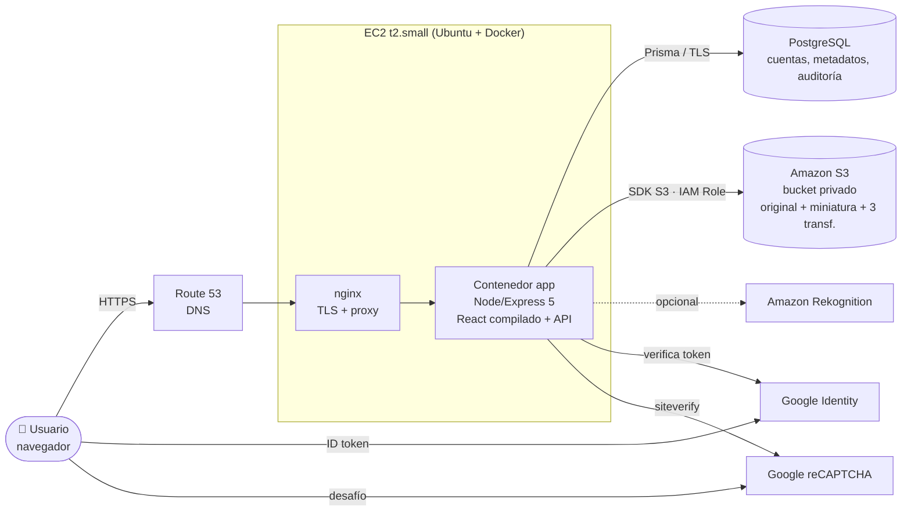

# 2. Diagrama distribuido de componentes

## Componentes
| Componente | Rol | Código |
|---|---|---|
| Frontend React | UI y detección de rostros en el cliente | `FRONTEND/src` |
| API Express | Rutas, autenticación, procesamiento, auditoría | `BACKEND/` |
| sharp | Miniaturas y transformaciones | `services/images.js` |
| storage | Abstracción S3 / disco | `services/storage.js` |
| PostgreSQL | Datos relacionales | `prisma/schema.prisma` |
| S3 | Archivos de imagen | `infra/s3/create-bucket.sh` |
| IAM Role | Acceso de la EC2 a S3/Rekognition sin claves | `infra/iam/` |
| Route 53 | Dominio | `infra/route53/` |
