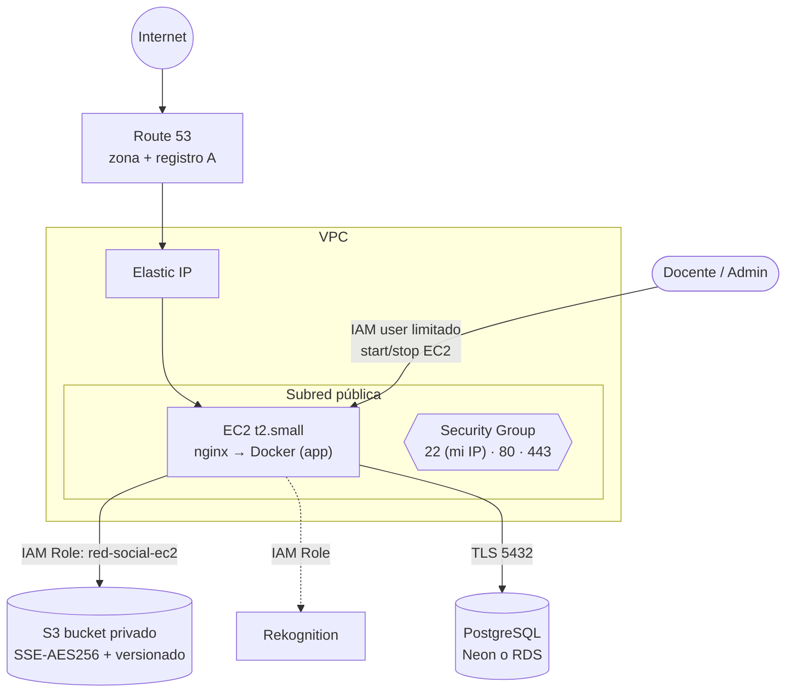

# 9. Diagramas de Cloud Computing

## Despliegue en AWS (región N. Virginia, us-east-1)

## Modelo de servicio utilizado
| Recurso | Modelo | Nota |
|---|---|---|
| EC2 | IaaS | Se administra SO, Docker y nginx |
| S3, Rekognition, Route 53 | PaaS/SaaS gestionado | Sin servidores que mantener |
| PostgreSQL (Neon/RDS) | DBaaS | Respaldos gestionados |
| Google Identity, reCAPTCHA | SaaS | Terceros |

## Costos y cuidado
`t2.small` se cobra mientras está encendida: **suspéndela** al terminar (el enunciado lo exige). Una IP elástica sin instancia en ejecución también se cobra.
