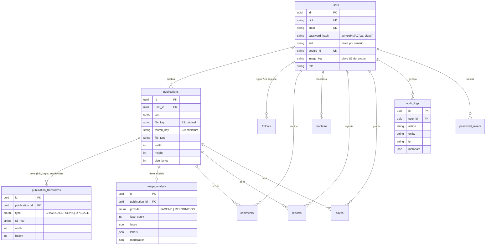

# Entregable 1 · Documentación del desarrollador

Arquitectura, flujo y decisiones: ver `docs/publica/01_arquitectura_solucion.md` y `02_diagrama_componentes.md`.
Esta página documenta el **esquema de la base de datos** (PostgreSQL, definido en `prisma/schema.prisma`).

## Diagrama entidad–relación


## Tablas principales
| Tabla | Propósito | Claves e índices |
|---|---|---|
| `users` | Cuentas (correo/contraseña o Google) | `email` y `nick` únicos, `google_id` único |
| `publications` | Una foto: texto, **claves** S3 y dimensiones | `user_id`, `created_at` |
| `publication_transforms` | Variantes generadas por foto | único `(publication_id, type)` |
| `image_analysis` | Rostros/etiquetas/moderación | único `publication_id` |
| `audit_logs` | Bitácora de transacciones | `(user_id, created_at)`, `(action, created_at)` |
| `follows`, `comments`, `reactions`, `reposts`, `saves` | Funciones sociales (backend listo) | únicos y compuestos según el esquema |
| `password_resets` | Tokens (solo hash) de recuperación | `token_hash` único |

**`reactions` no tiene claves foráneas a propósito:** `target_id` apunta a una publicación o a un comentario (según `kind`). Dos claves foráneas sobre la misma columna exigirían que el id existiera en ambas tablas, lo que hacía imposible guardar un me gusta (corregido en la migración `20261107000000_fix_reactions_fk`). El código borra las reacciones al eliminar una publicación o comentario.

**Las imágenes no están en la BD**: solo `file_key`, `thumb_key` y `s3_key` apuntan a objetos de S3. Al borrar una publicación, sus transformaciones, análisis, comentarios y reacciones se eliminan en cascada.

## Estructura de claves en S3
```
photos/{userId}/{photoId}/original.{jpg|png|webp}
photos/{userId}/{photoId}/thumb.jpg
photos/{userId}/{photoId}/grayscale.jpg
photos/{userId}/{photoId}/sepia.jpg
photos/{userId}/{photoId}/upscale.jpg
avatars/{userId}/{timestamp}.jpg
```

## API
Ver tabla completa en `docs/publica/05_aplicacion_web.md`.

## Pruebas
`npm test` ejecuta 25 pruebas: servicios de imágenes, almacenamiento, contraseñas, análisis y un recorrido de la API (registro → subida → galería → detalle → borrado → auditoría) con una base de datos en memoria.
